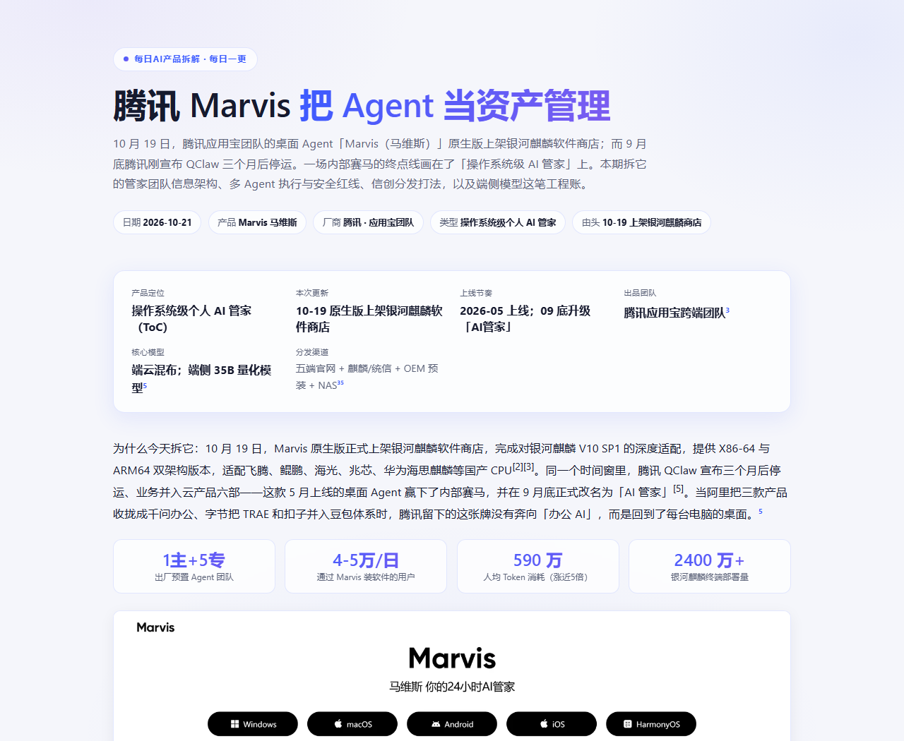

# AI Product Teardown

把一款 AI 产品拆成一份**能直接发出去**的图文报告：真实产品界面截图 + 控件级功能描述 + 可被反驳的结论。产出单文件 HTML，图片 base64 内嵌，双击即开，微信可直接转发。

> A skill that turns an AI product into a self-contained, screenshot-rich HTML teardown report. Built for product managers who need to show evidence, not opinions.



上图是用本 skill 生成的《腾讯 Marvis · 把 Agent 当资产管理》首屏：一屏内完整呈现标题、一句话摘要、元信息 chips、六格产品卡、开场论证、四个指标卡与正文配图。

## 它解决什么问题

市面上的产品分析大多死在两件事上：

1. **配图是资讯站的新闻照，不是产品界面。** 读者看完还是不知道这产品长什么样、有几个按钮、怎么配置。
2. **描述停在形容词层。** "界面简洁、功能强大、体验流畅"——这种话换个产品名照样成立。

这个 skill 用三条硬规则掐死这两种偷懒，并把截图抓取、图质量筛选、报告生成做成可复用的脚本。

## 三条铁律

### 一、图必须是产品功能界面，不是资讯配图

判定标准：**图里能不能看见产品自身的控件**（按钮、表单、列表列头、导航、状态标签、配置项）。看不见就不算。

来源按优先级取：

| 级别 | 来源 | 特征 | 抓取方式 |
|---|---|---|---|
| **S** | 官方帮助中心 / 文档中心（`support.*` `help.*` `docs.*`） | 控制台截图，原生 1200–2560px，无登录弹窗 | `mode: imgs` 提原图 |
| **A** | 免登录产品界面（商店、广场、公开 Demo、Playground） | 真实 UI，无需鉴权 | `mode: page` |
| **B** | 官网产品页功能模块 | 需甄别是否带占位灰条的 mockup | `mode: page` + `selector` |
| **C** | 应用商店截图 | 移动端产品 | 手动 |
| **D** | 资讯 / 新闻配图 | 仅补位，≤2 张，caption 须标注 | 手动 |

一句话：**要真界面就翻文档，要真流程就去商店，官网产品页只能当备胎。**

### 二、功能描述必须落到控件级

读者只看文字不看图，能不能在脑子里还原出页面有哪几个控件、怎么排布、点了会发生什么。

> 反例："智能体创建页面设计得非常直观。"
>
> 正例："创建页左右分栏——左栏填名称/描述/图标/分类四个必填项，右栏是智能体对客形态的实时预览，改名字右侧立刻同步。这个设计说明产品把『创建』理解为一次可视化配置，而不是写配置文件。"

### 三、结论要能被反驳

每条 takeaway 的判据：如果同行说出一个相反的版本，能不能激起争论？不能，就是废话。

> 反例："好的产品设计能提升用户体验。"
>
> 正例："Agent 平台的竞争点已经从『能不能建』转到『建完之后怎么评估』——评估集、回归测试、效果看板成了标配，说明这个赛道正从工具期进入工程期。"

## 快速开始

### 1. 安装

```bash
git clone git@github.com:silence694/ai-product-teardown.git

# 放到 skill 目录，二选一
# 用户级（所有项目可用）
cp -r ai-product-teardown ~/.workbuddy/skills/
# 项目级（仅当前项目）
cp -r ai-product-teardown <your-project>/.workbuddy/skills/

# 装依赖
cd ai-product-teardown && npm install
pip install Pillow
```

### 2. 让 agent 加载它

对 WorkBuddy 说「拆解 XX 产品」，skill 会被自动匹配加载；也可以显式指定 `ai-product-teardown`。

### 3. 或者手动跑管线

```bash
# 建 spec 脚手架
python scripts/teardown_build.py --init 产品名 2026-01-01

# 抓截图（配置写法见 references/spec-schema.md）
node scripts/shot_capture.js spec/_capture.json

# 图片打分，剔掉营销插画
python scripts/pick_ui.py spec/shots --apply

# 人工逐张复核（这一步不能省，脚本会漏判线框图和空态页）

# 生成 HTML 并体检
python scripts/teardown_build.py spec/产品名_2026-01-01.json
```

## 目录结构

```
SKILL.md                          # 主文档：铁律、工作流、自检清单
references/
  screenshot-playbook.md          # 各类产品（云厂商/大模型应用/HR SaaS/移动端/海外）的截图入口与失效模式
  content-playbook.md             # 六维观察框架、描述颗粒度对照、注水表达黑名单
  spec-schema.md                  # spec.json 全部区块类型与字段
scripts/
  shot_capture.js                 # 截图抓取（page / imgs 两种模式）
  pick_ui.py                      # 界面图打分与剔除
  teardown_build.py               # spec.json → 单文件 HTML
assets/
  teardown.css                    # 报告版式，构建脚本自动读取
```

## 依赖

| 依赖 | 用途 | 缺失后果 |
|---|---|---|
| `playwright-core` | 驱动浏览器截图 | 无法抓图 |
| Chromium / Chrome / Edge | 浏览器本体 | 无法抓图 |
| `Pillow` | 图片压缩与格式转换 | 不报错，但 HTML 会因图片未压缩而变大 |

浏览器定位顺序：环境变量 `CHROME_PATH` → `ms-playwright` 缓存扫描 → 系统 Chrome/Edge。换机器、换 playwright 版本都不用改脚本。

## 已知限制

- **`pick_ui.py` 的打分只是初筛。** 它基于白底率、饱和度、边缘密度，线框图和空态页会骗过检测——所以工作流里「逐张肉眼复核」是不可跳过的一步。
- **`mode: imgs` 依赖文档站的 DOM 结构**，站点改版后选择器可能需要调。
- **只处理中文和英文页面**，其他语种未做验证。
- **不做内容判断。** 产品该拆哪一面、结论对不对，仍然靠人。

## 版本

- `v1.0` — 初版。三条铁律 + 三段工具链 + 固定版式。

## License

MIT
